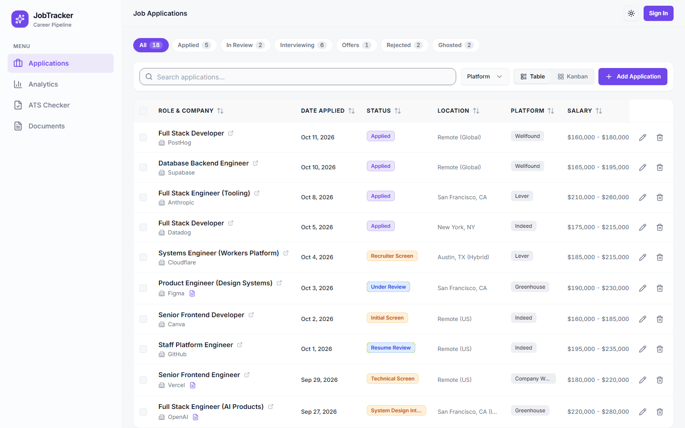
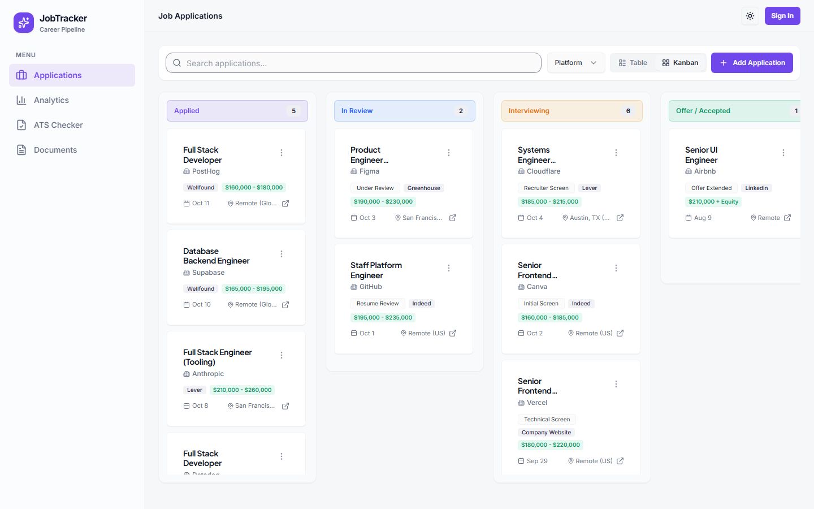
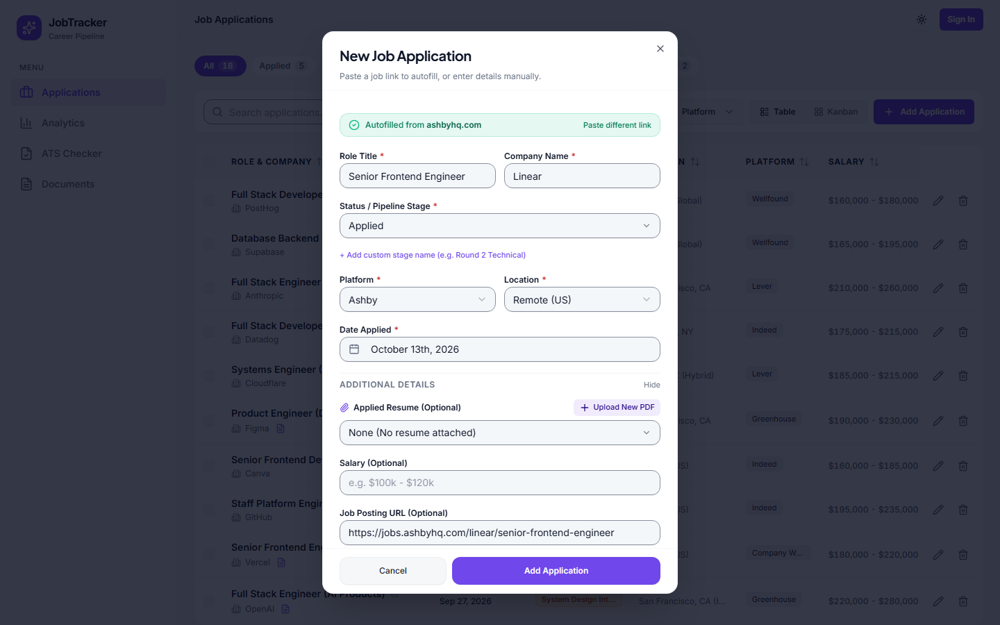
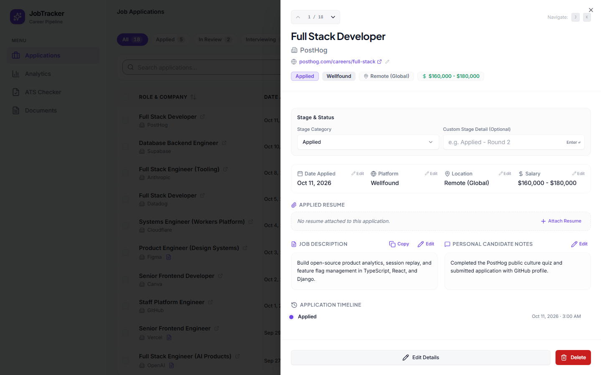
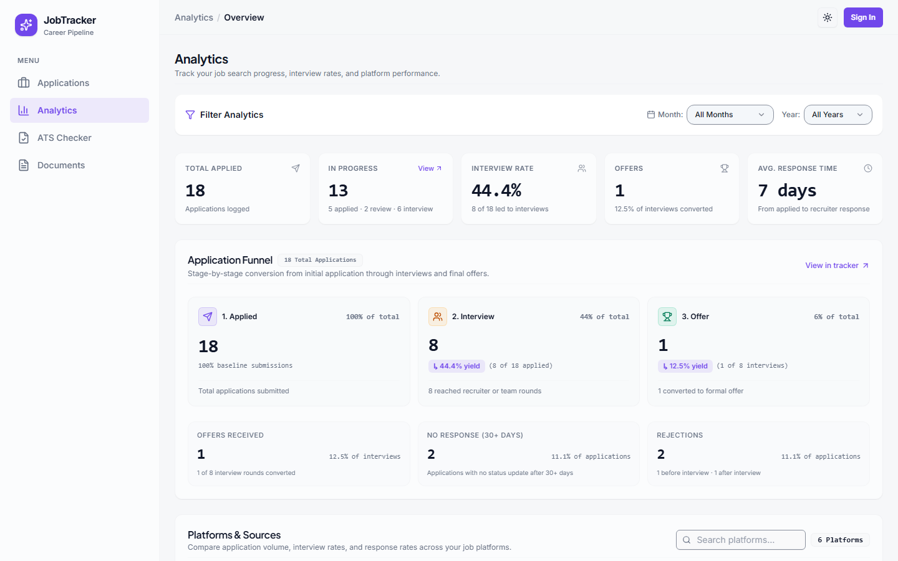
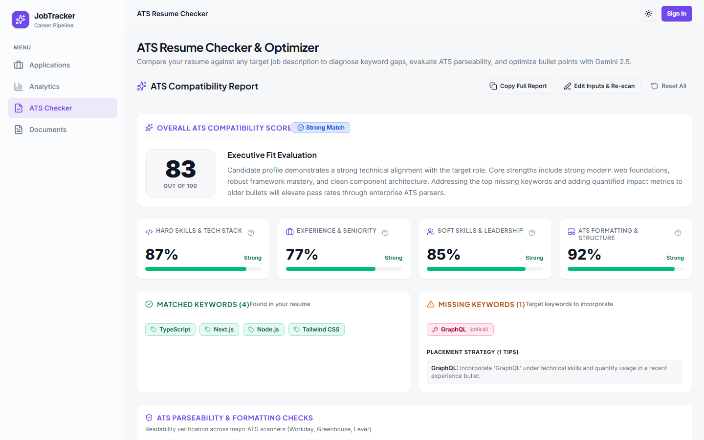
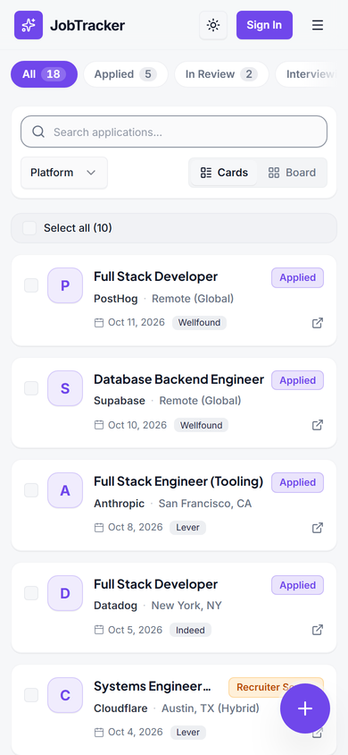

# Job Application Tracker

A job search workspace for people applying at volume. Paste a job link and the app fills in the application for you, then track every application through your pipeline, see which platforms actually get you interviews, and check your resume against a job description before you apply.

Built with Next.js 16, React 19, Drizzle ORM on Neon Postgres, Clerk, and Google Gemini.

<picture>
  <source media="(prefers-color-scheme: dark)" srcset="docs/screenshots/applications-table-dark.png">
  
</picture>

## Highlights

- **Link-first entry.** Paste a posting URL and the role, company, platform, location and description are filled in. Known job boards are parsed deterministically, with no AI call. Everything else falls back to Gemini structured output.
- **Two views of one pipeline.** A sortable table and a Kanban board share search, status and platform filters, all kept in the URL so views are shareable and survive a refresh.
- **Honest status history.** Every status change is recorded on a timeline. Applications with no movement for 30 days are moved to Ghosted automatically.
- **Analytics that answer real questions.** Interview and response rates per platform, a conversion funnel, salary transparency, remote vs. on-site mix and yearly trends.
- **ATS resume checker.** Scores a resume against a job description, lists matched and missing keywords, checks formatting, and suggests rewritten bullets.
- **No sign-up wall.** Visitors get a guest workspace right away; their data moves to their account when they sign in.
- **Careful UI.** Light and dark themes, keyboard navigation, unsaved-changes protection on every form, and WCAG AA contrast for text and form controls.

## Screenshots

<table>
  <tr>
    <td width="50%">
      <picture>
        <source media="(prefers-color-scheme: dark)" srcset="docs/screenshots/applications-kanban-dark.png">
        
      </picture>
      <p align="center"><sub>Kanban board</sub></p>
    </td>
    <td width="50%">
      <picture>
        <source media="(prefers-color-scheme: dark)" srcset="docs/screenshots/add-autofilled-dark.png">
        
      </picture>
      <p align="center"><sub>Autofill from a job link</sub></p>
    </td>
  </tr>
  <tr>
    <td width="50%">
      <picture>
        <source media="(prefers-color-scheme: dark)" srcset="docs/screenshots/application-detail-dark.png">
        
      </picture>
      <p align="center"><sub>Detail panel and timeline</sub></p>
    </td>
    <td width="50%">
      <picture>
        <source media="(prefers-color-scheme: dark)" srcset="docs/screenshots/analytics-overview-dark.png">
        
      </picture>
      <p align="center"><sub>Analytics</sub></p>
    </td>
  </tr>
  <tr>
    <td width="50%">
      <picture>
        <source media="(prefers-color-scheme: dark)" srcset="docs/screenshots/ats-result-dark.png">
        
      </picture>
      <p align="center"><sub>ATS resume checker</sub></p>
    </td>
    <td width="50%" align="center">
      <picture>
        <source media="(prefers-color-scheme: dark)" srcset="docs/screenshots/mobile-dark.png">
        
      </picture>
      <p align="center"><sub>Mobile</sub></p>
    </td>
  </tr>
</table>

## Features

### Tracking

- Table and Kanban views, with status filter pills, full-text search and a platform filter. View, filters, search and page live in the URL (via [nuqs](https://nuqs.47ng.com/)).
- Pipeline stages: **Applied**, **In Review**, **Interview**, **Accepted / Offer**, **Rejected**, **Ghosted** and **Other**. Each stage can carry a custom label such as "Recruiter Screen" or "Round 2 Technical".
- Detail panel with inline editing, a status timeline, an attached resume, and J/K (or arrow key) navigation between applications.
- Bulk select, bulk status change and bulk delete.
- Unsaved-changes protection: closing a form by any route (Esc, clicking outside, close button, navigation) asks before discarding edits.

### Autofill from a job link

When you paste a URL, `/api/extract` tries the cheapest method first:

1. **Deterministic parsers** (`lib/parsers/`): board-specific public APIs, embedded data, Schema.org `JobPosting` JSON-LD and page metadata. No AI call is made.
2. **Page retrieval** (`lib/scraper.ts`), if parsing is incomplete: direct HTML fetch, then the [Jina Reader](https://jina.ai/reader/), then an optional external scraper service (`SCRAPER_SERVICE_URL`), then local Playwright (development only).
3. **Gemini** (`gemini-2.5-flash-lite`) turns the retrieved page into structured fields.

| Coverage | Job boards |
|---|---|
| Dedicated parsers | Greenhouse, Lever, Ashby, Comeet, SmartRecruiters, Workable, Workday, LinkedIn, Indeed |
| Recognized; handled by the JSON-LD / metadata parsers and the Gemini fallback | ZipRecruiter, Glassdoor, Wellfound, BambooHR, Breezy HR, Rippling, Jobvite, Recruitee, JazzHR |
| Anything else | Generic JSON-LD and metadata parsing, then the Gemini fallback |

Fields the extraction can't find, such as a missing location, are left empty and flagged for you to fill in rather than guessed. Extraction can be cancelled, and you can switch to manual entry at any time.

### Analytics

A single dashboard, filterable by month and year:

- KPI strip: total applied, in progress, interview rate, offers, and average response time.
- Conversion funnel from application to interview to offer.
- Platform performance: interview and response rates per job board.
- Market reality: salary transparency, remote vs. on-site mix, and ghosting.
- Year-over-year trends.

### ATS resume checker

- Input: a saved resume, an uploaded PDF, or pasted text, plus the job description.
- Output: an overall score and four dimension scores (hard skills, experience, soft skills, formatting), matched and missing keywords with placement tips, a formatting checklist, and bullet rewrites. Powered by `gemini-2.5-flash`.

### Documents

- Upload PDF resumes (up to 10 MB) to Amazon S3 through presigned URLs, and attach them to applications.
- The ATS checker can reuse any saved resume.

### Accounts

- [Clerk](https://clerk.com/) authentication.
- Guests are identified by a signed cookie, so the app works without an account. Guest data is migrated to your account when you sign in.

## Tech stack

| Area | Technology |
|---|---|
| Framework | [Next.js 16](https://nextjs.org/) (App Router, Turbopack), [React 19](https://react.dev/), [TypeScript 7](https://www.typescriptlang.org/) |
| Data | [Neon](https://neon.tech/) serverless Postgres, [Drizzle ORM](https://orm.drizzle.team/) and drizzle-kit |
| Auth | [Clerk](https://clerk.com/) |
| AI | [Google Gen AI SDK](https://ai.google.dev/) (Gemini 2.5 Flash and Flash-Lite) |
| Storage | Amazon S3 (`@aws-sdk/client-s3`, presigned URLs) |
| UI | [Tailwind CSS v4](https://tailwindcss.com/), [Radix UI](https://www.radix-ui.com/), [shadcn/ui](https://ui.shadcn.com/), [Lucide](https://lucide.dev/), [Recharts](https://recharts.org/) |
| Forms and tables | [React Hook Form](https://react-hook-form.com/), [Zod 4](https://zod.dev/), drizzle-zod, [TanStack Table](https://tanstack.com/table) |
| Testing | [Playwright](https://playwright.dev/) |

## Getting started

### Prerequisites

- Node.js 20.9 or newer (developed on Node 24)
- npm

### Quick start (no external services)

```bash
git clone https://github.com/eytanbab/job-application-tracker.git
cd job-application-tracker
npm install
npm run dev
```

Open [http://localhost:3000](http://localhost:3000). With no environment variables set, the app runs in a self-contained demo mode:

- Data lives in an in-memory mock store with seed applications. It resets when the server restarts.
- You use the app as a guest; signing in needs Clerk keys.
- Without a Gemini key, link autofill returns placeholder values and the ATS checker returns a sample analysis.
- Without S3, uploads go to a mock location.

### Full setup

Create `.env.local` in the project root and fill in the services you want (see [Environment variables](#environment-variables)), then apply the database migrations:

```bash
npm run db:migrate
npm run dev
```

## Environment variables

| Variable | Needed for | Notes |
|---|---|---|
| `DATABASE_URL` | Persistent data | Neon Postgres connection string. If unset, the in-memory mock store is used. |
| `NEXT_PUBLIC_CLERK_PUBLISHABLE_KEY` | Sign-in | From the Clerk dashboard. |
| `CLERK_SECRET_KEY` | Sign-in, guest sessions | Also signs the guest cookie. Set it in any deployed environment. |
| `GEMINI_EXTRACTION_API_KEY` | Link autofill | Google AI Studio key used by `/api/extract`. |
| `GEMINI_ATS_API_KEY` | ATS checker | Google AI Studio key used by the resume analysis. |
| `GEMINI_API_KEY` | Either of the above | Fallback used when the specific Gemini key is not set. |
| `NEXT_AWS_S3_BUCKET_NAME` | Document uploads | If unset, uploads use a mock location. |
| `NEXT_AWS_S3_REGION` | Document uploads | Defaults to `us-east-1`. |
| `NEXT_AWS_S3_ACCESS_KEY_ID` | Document uploads | IAM credentials with access to the bucket. |
| `NEXT_AWS_S3_SECRET_ACCESS_KEY` | Document uploads | |
| `SCRAPER_SERVICE_URL` | Optional | External scraper service, tried before local Playwright for pages that need a browser. |
| `CRON_SECRET` | Scheduled jobs | Bearer token required by `/api/cron/sync-ghosted` when set. |
| `E2E_USER_EMAIL`, `E2E_USER_PASSWORD` | End-to-end tests | A Clerk test user. Can live in `.env.test`. |

Never commit real keys. `.env*` files are git-ignored.

## Database

- Schema: `app/db/schema.ts`. Migrations: `migrations/`.
- After changing the schema, generate a migration with `npm run db:generate`, then apply it with `npm run db:migrate`.
- Don't edit migration files once they are committed.

## Scripts

| Command | Description |
|---|---|
| `npm run dev` | Start the dev server with Turbopack |
| `npm run build` | Production build |
| `npm run start` | Serve the production build |
| `npm run test:e2e` | Run the Playwright end-to-end suite |
| `npm run db:generate` | Generate a Drizzle migration from schema changes |
| `npm run db:migrate` | Apply pending migrations |
| `npm run doctor` | Run [React Doctor](https://www.npmjs.com/package/react-doctor) diagnostics |

## Testing

```bash
npx tsc --noEmit     # type check
npm run build        # production build
npm run test:e2e     # end-to-end tests
```

The end-to-end suite signs in as the Clerk test user from `E2E_USER_EMAIL` / `E2E_USER_PASSWORD` and starts the dev server on port 3000 itself, reusing one that is already running.

## Scheduled jobs

`GET /api/cron/sync-ghosted` moves applications that have been in Applied or In Review for 30 days without a status change to Ghosted. The same sync also runs after application changes. To run it on a schedule (for example with Vercel Cron), call it with `Authorization: Bearer <CRON_SECRET>`.

## Project structure

```text
app/
  (auth)/                 Clerk sign-in and sign-up pages
  (pages)/
    applications/         Table, Kanban, detail panel, bulk actions
    analytics/            Analytics dashboard
    ats-checker/          ATS resume checker
    documents/            Resume library
  _components/            Shared app components (application form, nav, autofill bar)
  actions/                Server actions (applications, analytics, ATS, documents, guest migration)
  api/                    Route handlers (/api/extract, /api/cron/sync-ghosted)
  db/                     Drizzle schema and database client
components/ui/            UI primitives (shadcn/ui on Radix)
hooks/                    Shared React hooks
lib/
  parsers/                Deterministic job board parsers
  mock-data/              In-memory store and seed data for demo mode
  security/               Guest token signing, URL validation
  scraper.ts              Page retrieval chain
  gemini.ts               Gemini clients
  s3-client.ts            S3 client
  utils.ts                Shared helpers (statuses, formatting)
e2e/                      Playwright tests
migrations/               Drizzle migrations
proxy.ts                  Clerk middleware and guest cookie
```

## Contributing

See [AGENTS.md](AGENTS.md) for code conventions, commit format (Conventional Commits) and the verification required before committing.

## License

[MIT](LICENSE)
